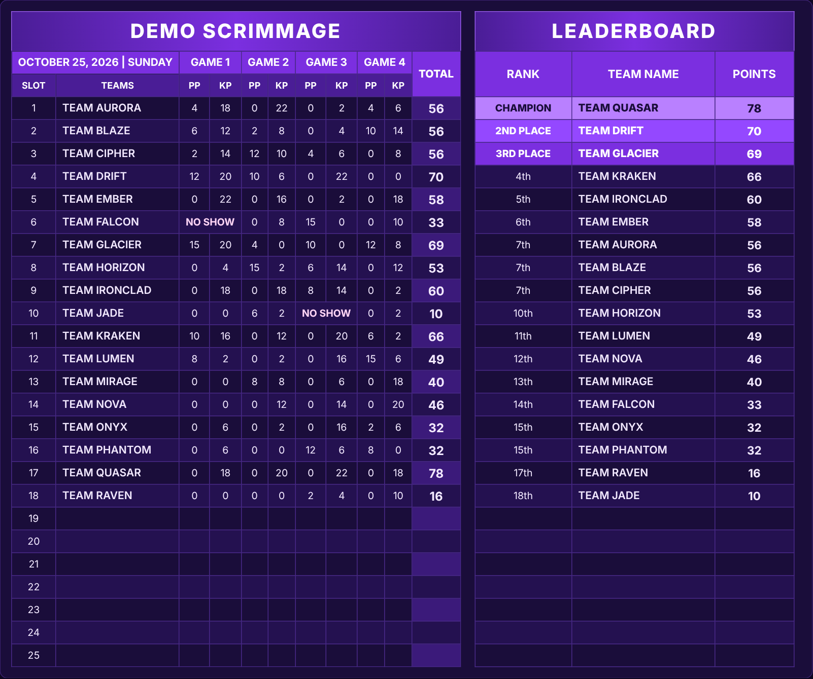
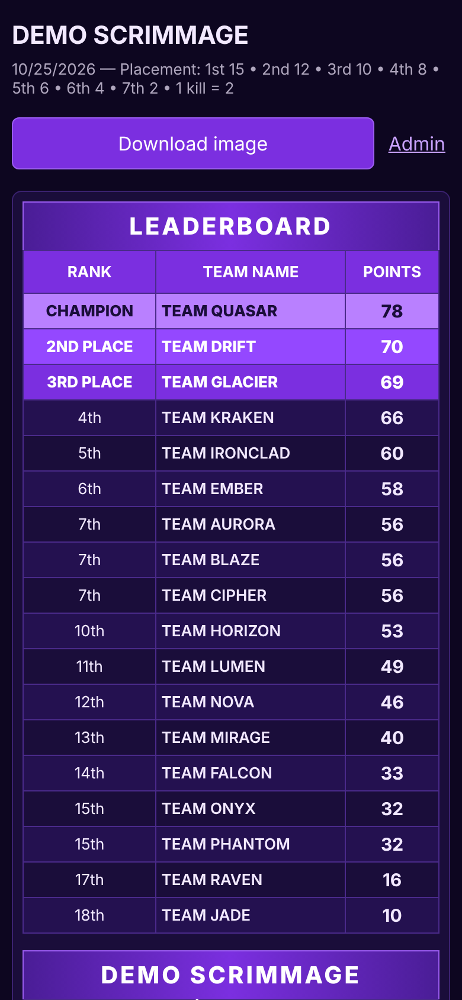
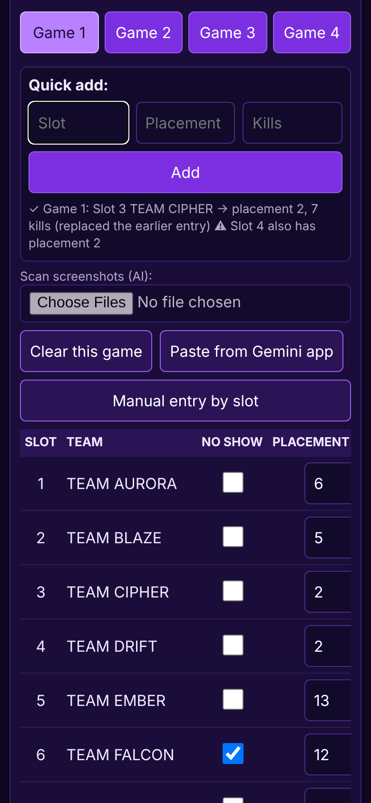
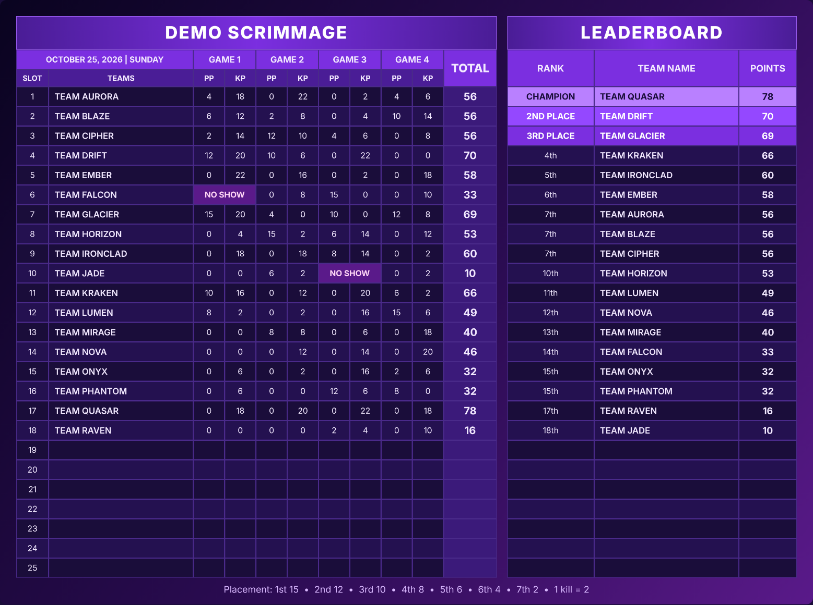

# Scrim Calculator

A small web app for running esports-style **scrimmages (custom-room matches) for a mobile battle royale game**. You enter each game's placements and kills, and it calculates the points and publishes a live leaderboard that players can open on their phones.

I built it to replace a manual spreadsheet: score keeping took a long time between games, and the standings had to be posted as an image by hand.



*Screenshots use made-up demo teams and results.*

## Features

- **Live leaderboard** page with a per-slot results table, per-game placement points (PP) and kill points (KP), totals, and a ranked leaderboard. Teams on equal points share a rank.
- **One-tap image export** of the standings, ready to post in a Discord or group chat.
- **Fast manual entry** during a match, three ways:
  - **Quick add:** type slot, placement and kills, then press Enter.
  - **Entry by slot:** a card per team with each player's kills added up automatically.
  - **Results table** for editing any value directly.
- **Screenshot reading with AI (optional):** upload result screenshots and Gemini (or Claude) extracts teams, placements and kills. Several screenshots are read in parallel and merged by lobby number. A "paste from the Gemini app" option works without an API key.
- **Multiple saved scrims:** keep a separate save for each day, start the next one with the same teams, and let viewers browse older scrims.
- **Mobile-friendly** admin and public pages (large tap targets, pinned columns, leaderboard first on phones).
- **Configurable scoring:** number of games and slots, points per kill and placement points table.

| Phone leaderboard | Phone admin |
|---|---|
|  |  |



## Tech stack

- **Backend:** Python, [Flask](https://flask.palletsprojects.com/)
- **Frontend:** plain HTML, CSS and JavaScript (no framework); the exported image is drawn with the Canvas API
- **Storage:** one JSON file per scrim, no database needed
- **AI (optional):** Google Gemini API or Anthropic API for reading screenshots

## Run it locally

You need Python 3.9 or newer.

```bash
# 1. Get the code
git clone https://github.com/YOUR-USERNAME/scrim-calculator.git
cd scrim-calculator

# 2. Install the two dependencies
pip install -r requirements.txt

# 3. Create your private settings file
cp config.example.py config.py      # on Windows: copy config.example.py config.py
# then open config.py and set ADMIN_PASSWORD and SECRET_KEY

# 4. Start the app
python app.py
```

Open <http://127.0.0.1:5000> for the public leaderboard and <http://127.0.0.1:5000/admin> to enter results.

The AI screenshot scan is optional. To use it, add a Gemini or Anthropic API key to `config.py`. Without a key, everything else still works.

## Project structure

```
app.py               Flask app: scoring, saved scrims, AI scan, API routes
config.example.py    Settings template (copy to config.py)
static/
  board.js           Leaderboard rendering (HTML and exported image)
  style.css          Styles, including the mobile layout
templates/
  index.html         Public leaderboard
  admin.html         Admin page: entry, scans, saved scrims
  login.html         Admin login
docs/                Screenshots used in this README
```

Saved scrims are written to a `scrims/` folder next to `app.py`. It is not part of the repository, so your results stay private.

## How scoring works

For each game, a team's points are `placement points + (kills x points per kill)`. Placement points come from a table you set (for example 1st = 15, 2nd = 12, ...). A team's total is the sum over all games, and a team that did not show up for a game scores 0 for it.

## Security notes

- The admin page is protected by a password from `config.py`. Change the defaults before putting the app online.
- `config.py` (passwords and API keys) and `scrims/` (your data) are listed in `.gitignore` and must never be committed.

## Ideas for later

- Automated tests for the scoring and the screenshot merge logic
- Hide selected scrims from the public list
- Export standings to CSV

## About

Built by https://github.com/senparmis-tech as a hands-on project to practise Flask, a small JSON-backed API, canvas drawing and mobile-first layout.
